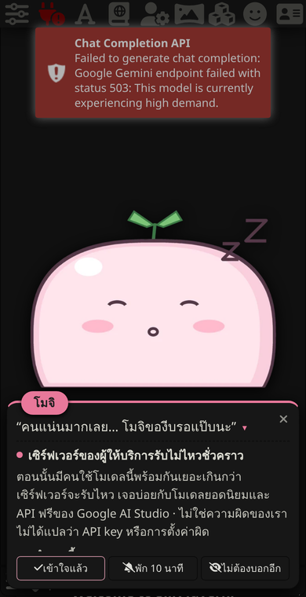
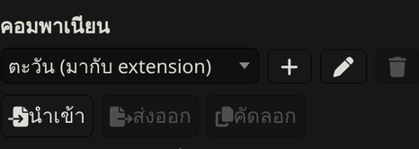
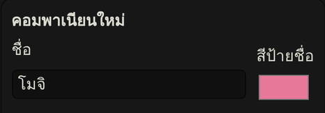
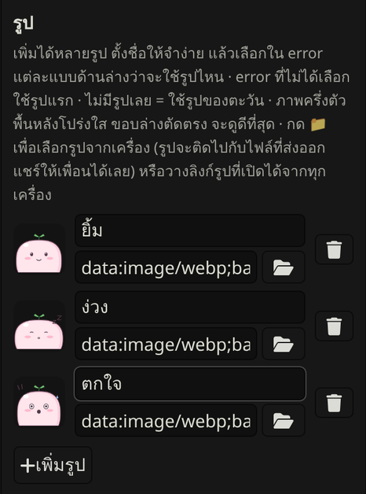
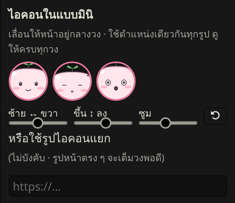
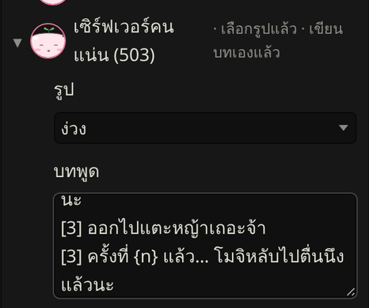
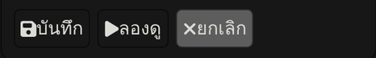
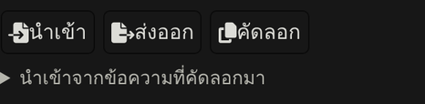

# ทำคอมพาเนียนของตัวเอง (แบบง่ายที่สุด)

ไม่ต้องเขียนโค้ด ไม่ต้องลงโปรแกรม ไม่ต้องฝากรูปที่ไหน ทำใน SillyTavern ได้ทั้งหมด



**ต้องมี:** SillyTavern ที่ลง Error Companion แล้ว กับรูปตัวละครอย่างน้อย 1 รูป

---

## ลองตัวอย่างก่อน: โมจิ

โมจิเป็นสไลม์ก้อนกลมที่วาดไว้เป็นตัวอย่าง มี 5 สีหน้า และบทพูดครบทุก error

1. เปิด [ไฟล์ mochi.companion.json](mochi/mochi.companion.json) แล้วกดปุ่มดาวน์โหลด (ลูกศรชี้ลง มุมขวาบนของไฟล์)
2. ใน SillyTavern: **Extensions → Error Companion → นำเข้า** แล้วเลือกไฟล์ที่เพิ่งโหลดมา
3. กด ▶ หน้า error ไหนก็ได้ในหน้าตั้งค่าเพื่อลองดู

> ดาวน์โหลดไม่ได้? เปิด[ไฟล์แบบข้อความล้วน](https://raw.githubusercontent.com/inathael-58/SillyTavern-Error-Companion/main/examples/mochi/mochi.companion.json) → เลือกทั้งหมดแล้วคัดลอก → วางในช่อง **"นำเข้าจากข้อความที่คัดลอกมา"** แล้วกด นำเข้า

---

## ทำตัวของเราเอง

### 1. เตรียมรูป

- **กี่รูปก็ได้** รูปเดียวก็ใช้ได้ แต่ถ้ามีหลายสีหน้าจะสนุกกว่า แนะนำ 3–6 แบบ:

  | สีหน้า | ใช้กับ error แบบไหน |
  |---|---|
  | ยิ้ม / ปกติ | error ที่ยังไม่รู้จัก, รูปเริ่มต้น |
  | ง่วง / เหนื่อย | เซิร์ฟเวอร์คนแน่น, โควตาหมด |
  | ตกใจ | เน็ตหลุด, เซิร์ฟเวอร์พัง |
  | งง | ตั้งค่าผิด, API key ผิด, หาโมเดลไม่เจอ |
  | เศร้า / ร้องไห้ | เครดิตหมด, ถูกปฏิเสธ |
  | เขิน / หน้าแดง | โดนตัวกรองเนื้อหาบล็อก |

- **ที่ดูดีที่สุด:** ครึ่งตัว (หรือเต็มตัว) **พื้นหลังโปร่งใส** ไฟล์ PNG และขอบล่างตัดตรง ๆ
- **พื้นหลังไม่โปร่งใส?** ใช้ได้เหมือนกัน แต่จะเห็นเป็นกรอบสี่เหลี่ยม ถ้าอยากลบพื้นหลัง ใช้เว็บลบพื้นหลังฟรีที่ถนัดได้เลย แล้วเซฟเป็น PNG
- **ใช้ AI เจนรูป?** ลองพรอมต์นี้ (เปลี่ยนส่วนที่เป็นตัวละครเอง):

  ```
  character expression sheet of [ตัวละครของเรา], waist-up, same pose and outfit in every panel,
  6 panels in a 3x2 grid: smiling, sleepy, shocked, confused, crying, blushing,
  plain white background, clean anime style
  ```

  ได้รูปรวมมาแล้ว ตัดเป็นรูปละช่องด้วยโปรแกรมแต่งรูปในมือถือหรือคอมก็ได้

> ⚠️ **รูปตัวละครจากเกม อนิเมะ หรือรูปที่คนอื่นวาด** ใช้เองได้ แต่ถ้าจะแชร์ให้คนอื่น ให้ส่งกันเป็นการส่วนตัว อย่าโพสต์สาธารณะหรืออัปขึ้น GitHub เพราะเจ้าของลิขสิทธิ์สั่งลบได้

### 2. สร้างคอมพาเนียนใหม่

**Extensions → Error Companion** → กดปุ่ม **＋** ข้างรายการคอมพาเนียน



ตั้ง **ชื่อ** และเลือก **สีป้ายชื่อ**



### 3. ใส่รูป

กด **＋ เพิ่มรูป** → กด 📁 แล้วเลือกรูปจากเครื่อง → ตั้งชื่อรูป (เช่น ยิ้ม, ง่วง, ตกใจ) ทำซ้ำจนครบทุกรูป



- รูปจะถูกย่อให้พอดีและ **เก็บไว้ในคอมพาเนียนเลย** ไม่ต้องอัปโหลดที่ไหน
- รูปแรกในรายการคือรูปที่ใช้กับ error ที่ยังไม่ได้เลือกรูป

### 4. จัดไอคอนวงกลม (ใช้ตอนเด้งแบบมินิ)

เลื่อนแถบ **ซ้าย↔ขวา**, **ขึ้น↕ลง** และ **ซูม** จนหน้าตัวละครอยู่กลางวง ดูให้ครบทุกวง (ทุกรูปใช้ตำแหน่งเดียวกัน)



### 5. เลือกรูปและเขียนบท ให้แต่ละ error

กดชื่อ error เพื่อเปิด → เลือก **รูป** → พิมพ์ **บทพูด**



- **บรรทัดละประโยค** ตอนเจอ error จะสุ่มขึ้นมาหนึ่งประโยค
- ขึ้นต้นบรรทัดด้วย `[3]` = ใช้ตั้งแต่เจอ error นี้ครั้งที่ 3 ของวัน (ไว้ใส่มุกตอนเจอบ่อย ๆ)
- `{n}` = จำนวนครั้งที่เจอ · `{name}` = ชื่อคอมพาเนียน
- **ไม่ต้องเขียนครบทุก error ก็ได้** error ที่ปล่อยว่างจะใช้บทของตะวัน (คำอธิบายจริงจังด้านล่างบทพูดใช้ร่วมกันทุกตัว)

ตัวอย่าง (เซิร์ฟเวอร์คนแน่น):

```
คนแน่นมากเลย… โมจิของีบรอแป๊บนะ
[3] ออกไปแตะหญ้าเถอะจ้า
[3] ครั้งที่ {n} แล้ว… โมจิหลับไปตื่นนึงแล้วนะ
```

### 6. ลองดู แล้วบันทึก

กด **▶ ลองดู** เพื่อดูหน้าตาจริง พอใจแล้วกด **บันทึก**



แก้ทีหลังได้ตลอด: เลือกคอมพาเนียนในรายการแล้วกด ✎

### 7. แชร์ให้เพื่อน



- **ส่งออก** → ได้ไฟล์ `.companion.json` ส่งไฟล์นี้ให้เพื่อนได้เลย (รูปติดไปในไฟล์ด้วย)
- **คัดลอก** → ได้ข้อความไว้วางในแชต (ถ้ามีรูปจากเครื่อง ข้อความจะยาวมาก ส่งเป็นไฟล์จะง่ายกว่า)
- เพื่อนกด **นำเข้า** แล้วเลือกไฟล์ ก็ใช้ได้ทันที

---

## เจอปัญหา?

| อาการ | ลองแบบนี้ |
|---|---|
| กด 📁 แล้วขึ้นว่าเปิดรูปไม่ได้ | ใช้ไฟล์ PNG, JPG หรือ WebP (ไฟล์ HEIC จากไอโฟน ให้แปลงเป็น JPG ก่อน) |
| ตัวละครดูเล็ก / ลอย ๆ | ครอปรูปให้ตัวละครเต็มกรอบ ไม่เหลือที่ว่างรอบ ๆ และให้ขอบล่างตัดที่ตัว |
| เห็นกรอบสี่เหลี่ยมรอบตัวละคร | รูปมีพื้นหลัง ลบพื้นหลังแล้วเซฟเป็น PNG |
| อยากให้ไฟล์ที่แชร์เล็กลง | (ไม่บังคับ) เอารูปไปฝากเว็บฝากรูปที่เปิดได้จากทุกเครื่อง แล้ววางลิงก์รูปในช่องข้าง 📁 แทน |

---

<sub>รูปโมจิในโฟลเดอร์นี้วาดขึ้นใหม่สำหรับตัวอย่างนี้ ใช้ ดัดแปลง และแชร์ต่อได้ตามสัญญาอนุญาตของ repo</sub>
