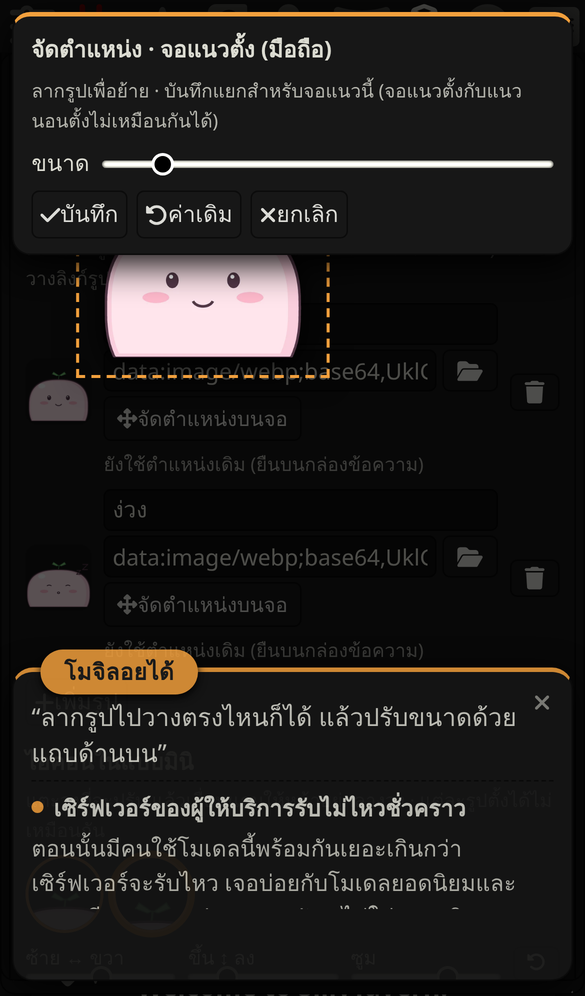
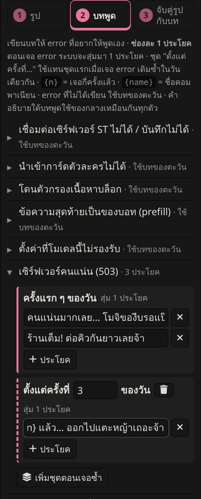
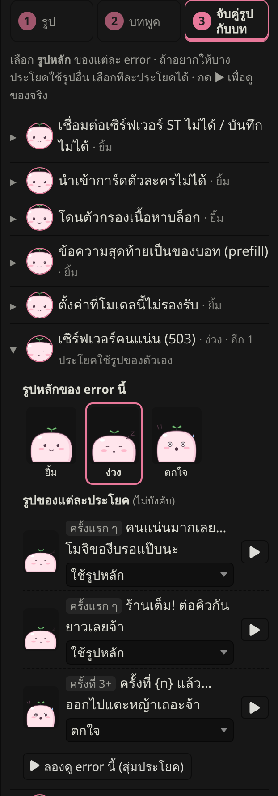

# ทำคอมพาเนียนของตัวเอง (แบบง่ายที่สุด)

ไม่ต้องเขียนโค้ด ไม่ต้องลงโปรแกรม ไม่ต้องฝากรูปที่ไหน ทำใน SillyTavern ได้ทั้งหมด


**ต้องมี:** SillyTavern ที่ลง Error Companion แล้ว กับรูปตัวละครอย่างน้อย 1 รูป

---

## ลองตัวอย่างก่อน: โมจิ

โมจิเป็นสไลม์ก้อนกลมที่วาดไว้เป็นตัวอย่าง มี 5 สีหน้า และบทพูดครบทุก error

1. เปิด [ไฟล์ mochi.companion.json](mochi/mochi.companion.json) แล้วกดปุ่มดาวน์โหลด (ลูกศรชี้ลง มุมขวาบนของไฟล์)
2. ใน SillyTavern: **Extensions → Error Companion → นำเข้า** แล้วเลือกไฟล์ที่เพิ่งโหลดมา
3. กด ▶ หน้า error ไหนก็ได้ในหน้าตั้งค่าเพื่อลองดู

> ดาวน์โหลดไม่ได้? เปิด[ไฟล์แบบข้อความล้วน](https://raw.githubusercontent.com/inathael-58/SillyTavern-Error-Companion/main/examples/mochi/mochi.companion.json) → เลือกทั้งหมดแล้วคัดลอก → วางในช่อง **"นำเข้าจากข้อความที่คัดลอกมา"** แล้วกด นำเข้า

---

## ทำตัวของเราเอง

### 1. เตรียมรูป

- **กี่รูปก็ได้** รูปเดียวก็ใช้ได้ แต่ถ้ามีหลายสีหน้าจะสนุกกว่า แนะนำ 3–6 แบบ:

  | สีหน้า | ใช้กับ error แบบไหน |
  |---|---|
  | ยิ้ม / ปกติ | error ที่ยังไม่รู้จัก, รูปเริ่มต้น |
  | ง่วง / เหนื่อย | เซิร์ฟเวอร์คนแน่น, โควตาหมด |
  | ตกใจ | เน็ตหลุด, เซิร์ฟเวอร์พัง |
  | งง | ตั้งค่าผิด, API key ผิด, หาโมเดลไม่เจอ |
  | เศร้า / ร้องไห้ | เครดิตหมด, ถูกปฏิเสธ |
  | เขิน / หน้าแดง | โดนตัวกรองเนื้อหาบล็อก |

- **ท่าไหนก็ได้:** ครึ่งตัว เต็มตัว นั่ง ลอยกลางอากาศ ขี่ไม้กวาด ฯลฯ เดี๋ยวจัดตำแหน่งและขนาดเองได้ตอนใส่รูป
- **ขนาดรูป:**

  | | แนะนำ |
  |---|---|
  | ชนิดไฟล์ | PNG หรือ WebP **พื้นหลังโปร่งใส** (JPG ก็ได้ แต่จะมีพื้นหลังติดมา) |
  | ความสูง | **อย่างน้อย 600 px** ถ้าจะให้ตัวใหญ่เต็มจอคอม ใช้ 1000 px |
  | ขนาดไฟล์ | **ไม่เกิน 1.5 MB ต่อรูป** (รูปจากเครื่องถูกย่อให้เหลือไม่เกิน 1000 px เอง) |

- **พื้นหลังไม่โปร่งใส?** ใช้ได้เหมือนกัน แต่จะเห็นเป็นกรอบสี่เหลี่ยม ถ้าอยากลบพื้นหลัง ใช้เว็บลบพื้นหลังฟรีที่ถนัดได้เลย แล้วเซฟเป็น PNG
- **ใช้ AI เจนรูป?** ลองพรอมต์นี้ (เปลี่ยนส่วนที่เป็นตัวละครเอง):

  ```
  character expression sheet of [ตัวละครของเรา], same outfit in every panel,
  6 panels in a 3x2 grid: smiling, sleepy, shocked, confused, crying, blushing,
  plain white background, clean anime style
  ```

  ได้รูปรวมมาแล้ว ตัดเป็นรูปละช่องด้วยโปรแกรมแต่งรูปในมือถือหรือคอมก็ได้

> ⚠️ **รูปตัวละครจากเกม อนิเมะ หรือรูปที่คนอื่นวาด** ใช้เองได้ แต่ถ้าจะแชร์ให้คนอื่น ให้ส่งกันเป็นการส่วนตัว อย่าโพสต์สาธารณะหรืออัปขึ้น GitHub เพราะเจ้าของลิขสิทธิ์สั่งลบได้

### 2. สร้างคอมพาเนียนใหม่

**Extensions → Error Companion** → กดปุ่ม **＋** ข้างรายการคอมพาเนียน


หน้าสร้างแบ่งเป็น **3 ขั้น** ทำทีละขั้นตามเลขด้านบน (กดชื่อขั้นเพื่อย้อนกลับไปแก้ได้ตลอด)

### 3. ขั้นที่ 1 · รูป

1. ตั้ง **ชื่อคอมพาเนียน** และเลือก **สีป้ายชื่อ**
2. กด **เพิ่มรูปจากเครื่อง** แล้วเลือกรูปทั้งหมดทีเดียว (เลือกหลายรูปพร้อมกันได้)
3. แก้ **ชื่อรูป** ให้จำง่าย เช่น ยิ้ม, ง่วง, ตกใจ


- รูปจะถูกย่อให้พอดีและ **เก็บไว้ในคอมพาเนียนเลย** ไม่ต้องอัปโหลดที่ไหน
- **รูปแรก** คือรูปเริ่มต้นของทุก error ที่ยังไม่ได้เลือกรูป (กด ↑ เพื่อเลื่อนลำดับ)

**ตำแหน่งบนจอ (ไม่บังคับ)** ถ้าไม่จัด ตัวละครจะยืนบนกล่องข้อความ เหมาะกับรูปครึ่งตัว ถ้าเป็นรูปเต็มตัว ลอยได้ หรืออยากให้อยู่มุมจอ:

1. กด **ตำแหน่งบนจอ** ในการ์ดของรูปนั้น ป๊อปอัปจริงจะเด้งขึ้นมา
2. **ลากรูป** ไปวางตรงไหนก็ได้ แล้วปรับ **ขนาด** ด้วยแถบด้านบน (บนคอมหมุนลูกกลิ้งเมาส์บนรูปได้)
3. กด **บันทึก**



- จอ **แนวตั้ง** (มือถือ) กับ **แนวนอน** (คอม แท็บเล็ต) **บันทึกแยกกัน** อยากให้สวยทั้งสองแบบ ก็จัดบนมือถือครั้งหนึ่ง แล้วไปจัดบนคอมอีกครั้ง
- รูปแต่ละรูปจัดแยกกันได้ เช่น รูปยืนอยู่ล่าง รูปบินอยู่บน

**ไอคอนมินิ** (วงกลมที่ใช้ตอนเด้งแบบมินิ) กด **ไอคอนมินิ** แล้วเลื่อนแถบ **ซ้าย/ขวา**, **ขึ้น/ลง** และ **ซูม** จนหน้าตัวละครอยู่กลางวง ถ้าทุกรูปท่าเดียวกัน กด **ใช้กับทุกรูป** ทีเดียวจบ


### 4. ขั้นที่ 2 · บทพูด

กด **ถัดไป** → กดชื่อ error เพื่อเปิด แล้วพิมพ์ **ช่องละ 1 ประโยค** (กด **＋ ประโยค** เพื่อเพิ่มช่อง)



- **ครั้งแรก ๆ ของวัน** = ประโยคที่สุ่มมาพูดตอนเจอ error นี้
- **เพิ่มชุดตอนเจอซ้ำ** → ตั้งเลข เช่น "ตั้งแต่ครั้งที่ **3** ของวัน" = พอเจอ error เดิมเป็นครั้งที่ 3 จะสุ่มจากชุดนี้แทน (ไว้ใส่มุกตอนเจอบ่อย ๆ)
- `{n}` = จำนวนครั้งที่เจอ · `{name}` = ชื่อคอมพาเนียน
- **ไม่ต้องเขียนครบทุก error ก็ได้** error ที่ปล่อยว่างจะใช้บทของตะวัน (กด **เริ่มจากบทของตะวัน** เพื่อก๊อปมาแก้ต่อก็ได้) คำอธิบายจริงจังด้านล่างบทพูดใช้ร่วมกันทุกตัว

### 5. ขั้นที่ 3 · จับคู่รูปกับบท

กด **ถัดไป** → กดชื่อ error เพื่อเปิด



- **รูปหลักของ error นี้** แตะรูปที่จะใช้
- **รูปของแต่ละประโยค** (ไม่บังคับ) ประโยคไหนอยากได้รูปอื่น เลือกในช่องใต้ประโยคนั้น
- กด ▶ ข้างประโยคเพื่อดูประโยคนั้นกับรูปนั้นบนจอจริง

### 6. ลองดู แล้วบันทึก

กด **▶ ลองดู** เพื่อดูหน้าตาจริง (สุ่ม error ที่ตั้งไว้) พอใจแล้วกด **บันทึก** (กดได้ทุกขั้น)


แก้ทีหลังได้ตลอด: เลือกคอมพาเนียนในรายการแล้วกด ✎

### 7. แชร์ให้เพื่อน


- **ส่งออก** → ได้ไฟล์ `.companion.json` ส่งไฟล์นี้ให้เพื่อนได้เลย (รูปติดไปในไฟล์ด้วย)
- **คัดลอก** → ได้ข้อความไว้วางในแชต (ถ้ามีรูปจากเครื่อง ข้อความจะยาวมาก ส่งเป็นไฟล์จะง่ายกว่า)
- เพื่อนกด **นำเข้า** แล้วเลือกไฟล์ ก็ใช้ได้ทันที

---

## เจอปัญหา?

| อาการ | ลองแบบนี้ |
|---|---|
| เพิ่มรูปแล้วขึ้นว่าเปิดรูปไม่ได้ | ใช้ไฟล์ PNG, JPG หรือ WebP (ไฟล์ HEIC จากไอโฟน ให้แปลงเป็น JPG ก่อน) |
| ตัวละครเล็กไป / อยู่ผิดที่ | กด **ตำแหน่งบนจอ** แล้วลากและขยาย · ถ้ารูปมีที่ว่างรอบตัวเยอะ ครอปให้ตัวละครเต็มกรอบก่อนจะจัดง่ายขึ้น |
| ย้ายจากมือถือไปคอมแล้วตำแหน่งเพี้ยน | จอแนวตั้งกับแนวนอนบันทึกแยกกัน จัดอีกรอบบนคอม |
| เห็นกรอบสี่เหลี่ยมรอบตัวละคร | รูปมีพื้นหลัง ลบพื้นหลังแล้วเซฟเป็น PNG |
| อยากให้ไฟล์ที่แชร์เล็กลง | (ไม่บังคับ) เอารูปไปฝากเว็บฝากรูปที่เปิดได้จากทุกเครื่อง แล้วใช้ **เพิ่มจากลิงก์** แทน |

---

<sub>รูปโมจิในโฟลเดอร์นี้วาดขึ้นใหม่สำหรับตัวอย่างนี้ ใช้ ดัดแปลง และแชร์ต่อได้ตามสัญญาอนุญาตของ repo</sub>
